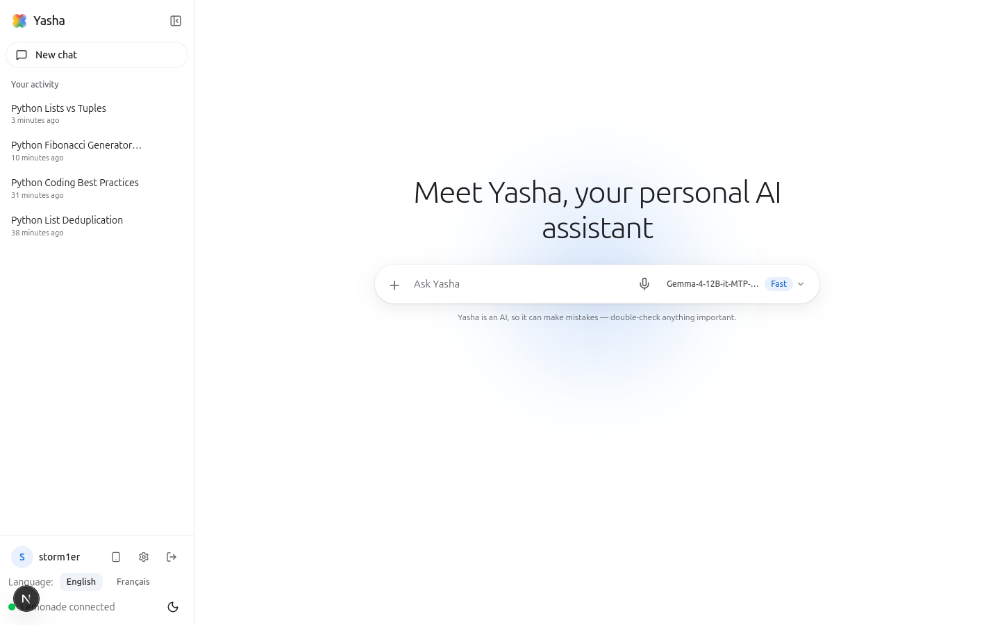
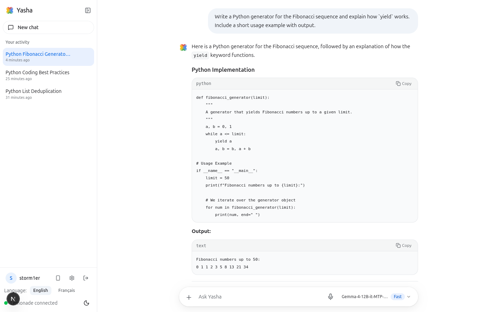
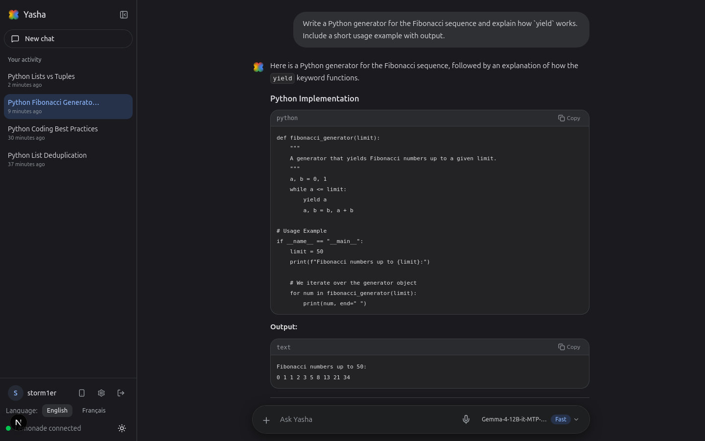
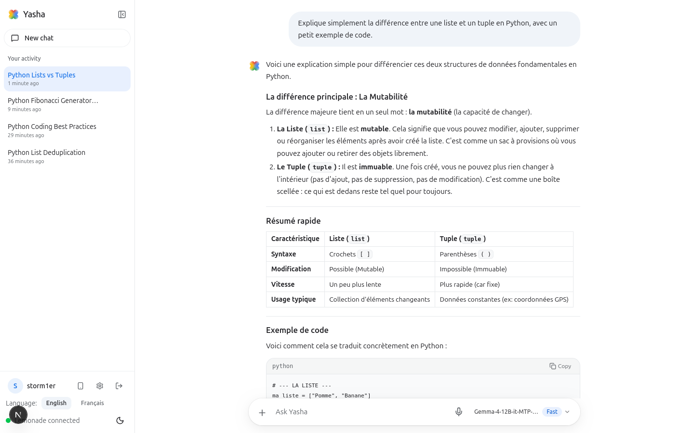
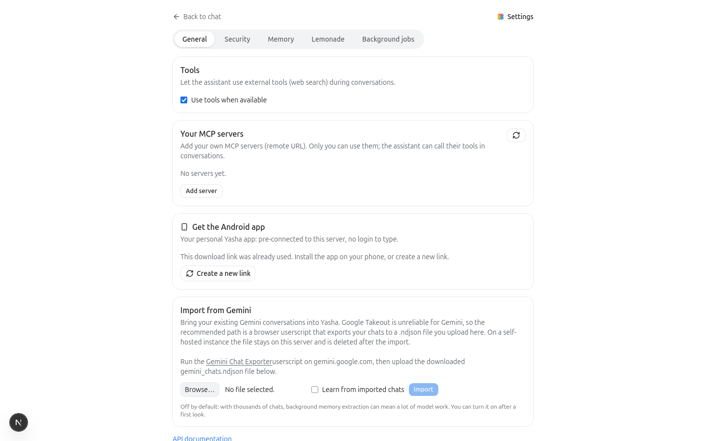
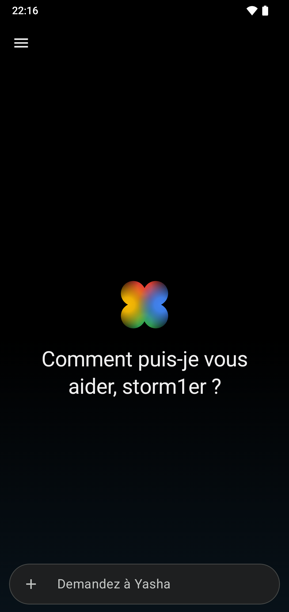
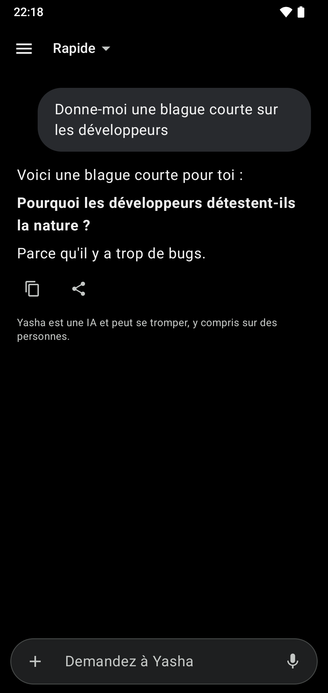
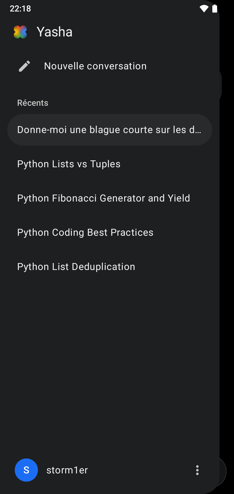

<div align="center">

# 🍋 Yasha

**Yet Another Self-Hosted Assistant** — a Gemini-style multi-user chat UI on top of a
[Lemonade](https://lemonade-server.ai) server.

Self-hosted · Private · Multi-language (en/fr) · Web + Android

[](LICENSE)
[](https://github.com/storm1er/yasha/actions/workflows/ci.yml)
[](https://github.com/storm1er/yasha/releases)
[](https://github.com/storm1er/yasha/pkgs/container/yasha)

</div>

> **Why?** Like [Immich](https://immich.app) is to Google Photos, Yasha aims to be my Google
> Gemini: a Gemini-like assistant you host yourself and share with your household or family —
> streaming chat, voice, memory, per-user accounts and a companion Android app — without giving
> anyone's conversations to a big-tech app. Your data, your server, your family's assistant.



## Features

- 🔐 Multi-user accounts (username + email/password, sessions via better-auth)
- 💬 Gemini-style chat: streaming responses, thread history, regenerate, code blocks with copy
- 🌙 Light/dark theme, 🇬🇧/🇫🇷 i18n (English + French)
- 📱 Responsive: desktop rail sidebar + mobile drawer
- 🔑 Per-user API keys (`/settings`) for the OpenAI-compatible `/v1` endpoint
  (docs at `/docs/api`)
- 🧠 Model routing via Lemonade (Fast/Smart pickers), health badge for backend status
- 🎙️ Voice input sent natively to audio-capable models — no transcription service to deploy
- 🧩 Memory & Gemini import, background job queue
- 🔎 Agentic tools via MCP (builtin ketch search server, admin-managed, per-user opt-out)
- 🤖 Companion Android assistant app (overlay mic, circle-to-ask, per-user APK builds)
- 🍋 Bundled Lemonade server container — or point Yasha at your own instance

## Screenshots

### Web

<table>
  <tr>
    <td></td>
    <td></td>
  </tr>
  <tr>
    <td></td>
    <td></td>
  </tr>
</table>

### Android companion app

<table>
  <tr>
    <td></td>
    <td></td>
    <td></td>
  </tr>
</table>

## Quickstart (self-hosted — no source checkout needed)

You need Docker and two files: `compose.prod.yml` (the whole stack) and a `.env`.

```bash
mkdir yasha && cd yasha
curl -fLO https://raw.githubusercontent.com/storm1er/yasha/HEAD/compose.prod.yml
curl -fLO https://raw.githubusercontent.com/storm1er/yasha/HEAD/.env.example
cp .env.example .env   # edit: YASHA_IMAGE, BETTER_AUTH_SECRET (openssl rand -hex 32),
                       # BETTER_AUTH_URL, BETTER_AUTH_TRUSTED_ORIGINS, BOOTSTRAP_ADMIN_*
docker compose -f compose.prod.yml up -d
```

Then browse `http://<host>:${PORT:-3000}` (behind your TLS proxy) — or let the **bundled
Caddy** terminate TLS for you on 80/443 with automatic Let's Encrypt:

```bash
curl -fLO https://raw.githubusercontent.com/storm1er/yasha/HEAD/compose.prod.caddy.yml
CADDY_ADDRESS=your.domain.tld docker compose -f compose.prod.yml -f compose.prod.caddy.yml up -d
```

The stack is two services: `web` (pre-built image from GHCR, published on loopback only) and
`lemonade` (the LLM backend, never published). All state lives in a single `yasha_data` volume —
SQLite DB (chat history & attachments included), import spool, APK artifacts — that is also your
whole backup. Prefer your own Lemonade? Set `LEMONADE_BASE_URL` in `.env` and scale the bundled
one to `replicas: 0`. Upgrades, restores, and the proxy checklist:
[docs/admin-guide.md](docs/admin-guide.md).

Voice input: tap the mic in chat and talk — the recording is sent natively to the
audio-capable fast model (Gemma 4 E2B/E4B/12B; see Settings → Lemonade) and gets a
readable caption from a background job. No transcription service to deploy.

### Single `docker run` (minimal)

If you run your own proxy/backend, one container suffices (the image also embeds the Android
toolchain for per-user APK builds, so expect ~2–4 GB):

```bash
docker run -d --name yasha \
  -p 127.0.0.1:3333:3000 \
  -v yasha-data:/data \
  --add-host=host.docker.internal:host-gateway \
  -e LEMONADE_BASE_URL=http://host.docker.internal:13305 \
  -e BETTER_AUTH_SECRET=*** rand -hex 32) \
  -e BETTER_AUTH_URL=https://<public-host> \
  -e BETTER_AUTH_TRUSTED_ORIGINS=https://<public-host> \
  -e BOOTSTRAP_ADMIN_USERNAME=… -e BOOTSTRAP_ADMIN_PASSWORD=*** \
  ghcr.io/storm1er/yasha:latest
```

On first boot an empty `/data` volume is automatically migrated and the bootstrap admin is
seeded. Your TLS proxy forwards `https://<public-host>` → `http://127.0.0.1:3333` with `Host` +
`X-Forwarded-Proto: https`.

Running from source instead? That's the contributor path — see [Development](#development) and
[CONTRIBUTING.md](CONTRIBUTING.md).

## Tools (MCP)

Yasha can equip the assistant with external tools over the Model Context Protocol.

- **Admin** (`/settings` → Tools card): enable/disable tools instance-wide, seed-included
  `ketch` MCP server ships builtin (web search/scrape/docs, via stdio), add remote MCP
  servers by URL with optional headers, run health checks, and exclude individual tools
  per server (denylist).
- **Users** (`/settings` → Tools): opt out of tool use on their own account
  (override of the instance default).
- Behaviour: during a chat turn the model may call tools; each call surfaces as a status
  chip (web + Android) and its result is fed back, up to a bounded number of rounds.
  The OpenAI-compatible `/v1` endpoint injects the same server tools only when the client
  sends none, and passes client-supplied `tools` through untouched.
- Settings keys: `mcp.enabled` (instance kill-switch, default on),
  `mcp.maxToolRounds`, `mcp.toolTimeoutMs`, `mcp.toolResultMaxChars`. Env:
  `MCP_ALLOW_PRIVATE_URLS=true` permits remote servers on private/loopback addresses.

## Documentation

| Doc | What's in it |
| --- | --- |
| [Admin guide](docs/admin-guide.md) | Install options, first boot, TLS, backups, upgrades, troubleshooting |
| [Configuration reference](docs/configuration.md) | Every environment variable & settings layer |
| [Architecture](docs/architecture.md) | Components, request flows, data model, security model |
| [API docs](app/docs/api) | In-app OpenAI-compatible `/v1` reference (`/docs/api` once running) |
| [Android app](android/README.md) | Companion app build & install |
| [Contributing](CONTRIBUTING.md) | Dev setup (containers only), tests, definition of done |
| [AGENTS.md](AGENTS.md) | Guardrails & harness for AI coding agents |

## Development (contributors — run from source)

Contributing? Run the app from the working tree with hot reload (`web` built with the `dev`
target, Lemonade port published for direct access):

```bash
cp .env.example .env # Then edit as needed
cp compose.override.yml.example compose.override.yml # Eventually edit as needed
docker compose up # Then navigate to http://localhost or http://localhost:3000 or http://localhost:13305
```

Check quality gates (all must pass, see [CONTRIBUTING.md](CONTRIBUTING.md)):

```bash
docker compose run --rm web sh -c 'npx tsc --noEmit && npm run lint && npx vitest run --coverage && npm run build'
```

### Database migrations

One-off tools run inside the dev-stage `web` image (deps + source come from the override):

```bash
# generate SQL migrations from the drizzle/ schema
docker compose -f compose.yml -f compose.override.yml run --rm web npx drizzle-kit generate

# push the schema straight to ./data/yasha.db (dev shortcut, no migration files)
docker compose -f compose.yml -f compose.override.yml run --rm web npx drizzle-kit push
```

## Contributing

Using AI to contribute to this project is allowed. Just make sure to keep personal workflow,
setup and specifics to your setup into `AGENTS.local.md` (gitignored — start from
`AGENTS.local.md.example`) so you never commit sensible datas. See
[CONTRIBUTING.md](CONTRIBUTING.md) for the full guide and
[CHANGELOG.md](CHANGELOG.md) for release history.

## License

Yasha is licensed under the [GNU AGPL-3.0](LICENSE).
